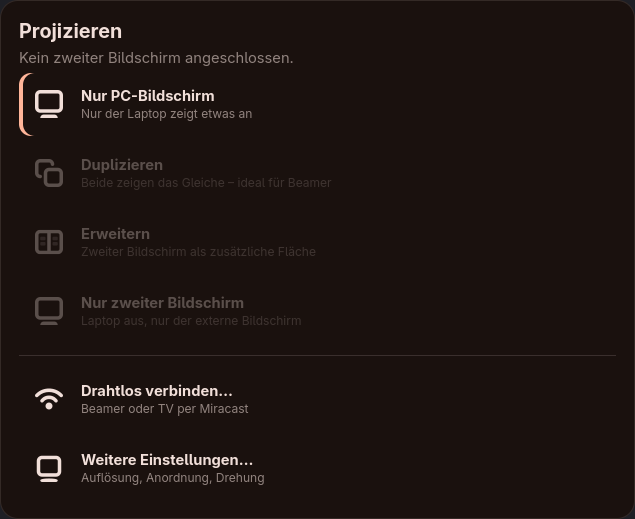
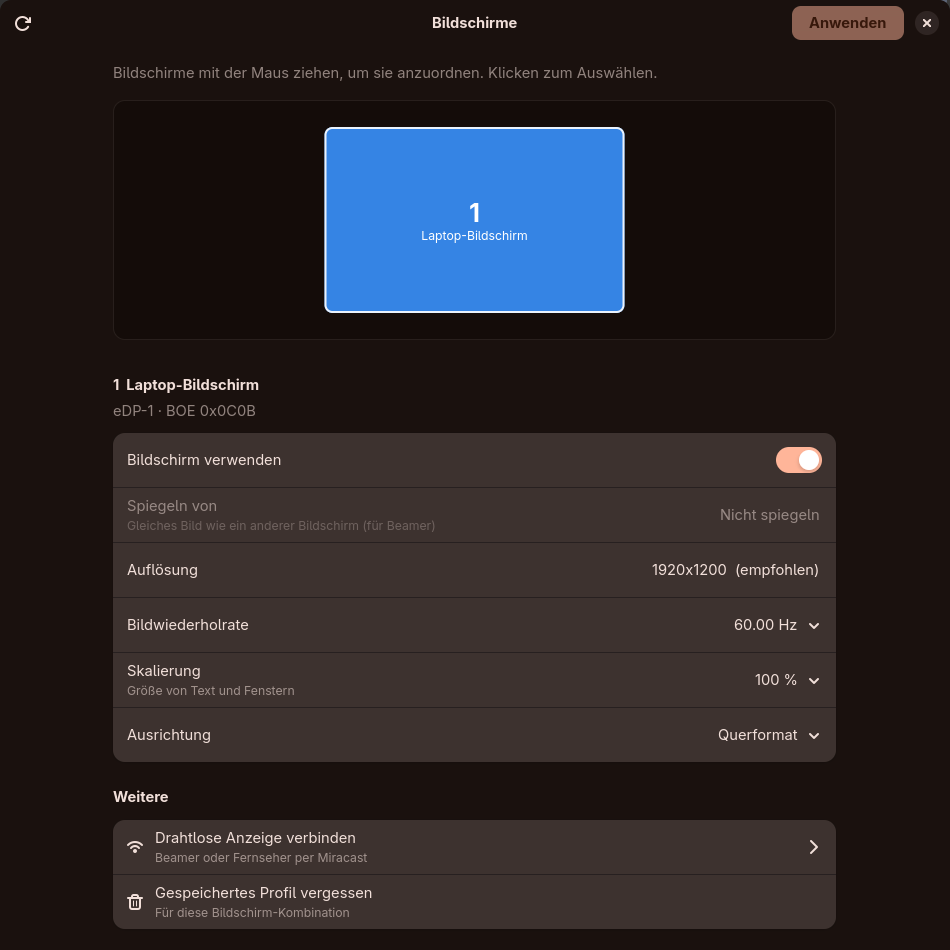

# window-display

**Windows-artige Bildschirm- und Beamer-Verwaltung für Hyprland und GNOME.**
Monitor einstecken → Menü erscheint → „Duplizieren“ klicken → fertig. Wie `Win+P`, nur auf Linux.

*Windows-style display & projector switcher for Hyprland and GNOME (Super+P menu, settings window, hotplug profiles).*

<p align="center">
  
  &nbsp;
  
</p>

## Features

- **Super+P-Schnellmenü** – *Nur PC-Bildschirm*, *Duplizieren*, *Erweitern*, *Nur zweiter Bildschirm*.
  Nochmal Super+P springt zur nächsten Option, Enter wendet an, Esc schließt.
- **Einstellungsfenster** – Bildschirme per Drag & Drop anordnen (rasten an den Kanten ein),
  Auflösung, Bildwiederholrate, Skalierung, Drehung, Spiegeln, an/aus.
- **Auto-Erkennung** – neuer Monitor oder Beamer eingesteckt → das Menü öffnet sich automatisch.
- **Profile** – jede bestätigte Einstellung wird pro Bildschirm-Kombination gemerkt und beim nächsten
  Einstecken sofort wieder angewendet (erkannt an Hersteller/Modell/Seriennummer, nicht am Anschluss).
- **Sicherheitsnetz** – nach jeder Änderung 15 s „Beibehalten?“, sonst automatische Rückkehr zur alten
  Einstellung. Es bleibt immer mindestens ein Bildschirm an; wird der einzige aktive Monitor abgezogen,
  schaltet sich der Laptop-Bildschirm wieder ein.
- **Aussehen** – folgt automatisch [Matugen](https://github.com/InioX/matugen) bzw. dem System-Theme
  (Farbwechsel beim Hintergrundbild-Wechsel live), oder selbst einstellen: Hell/Dunkel + Akzentfarbe.
  Dazu drei Stile: *Normal*, *Frosted Glass* (milchig, unscharfer Hintergrund) und *Liquid Glass*
  (durchsichtiger, mit Lichtkanten). Die Unschärfe macht Hyprland – für das Super+P-Menü setzt die App
  dafür zur Laufzeit eine Blur-Regel, an der Config wird nichts geändert. Auf GNOME (keine Unschärfe)
  sind die Glas-Stile deckender, damit alles lesbar bleibt.
- **Drahtlos (Miracast)** – startet [GNOME Network Displays](https://gitlab.gnome.org/GNOME/gnome-network-displays),
  falls installiert. Läuft trotz des Namens auch auf Hyprland (nutzt NetworkManager-Wi-Fi-P2P und
  `xdg-desktop-portal-hyprland` zum Bildschirm-Teilen).
- **Config bleibt sauber** – Einstellungen werden live gesetzt und in eigenen Profilen gespeichert.

## Unterstützte Desktops

| | Hyprland | GNOME |
|---|---|---|
| Monitore steuern über | `hyprctl eval 'hl.monitor({...})'` | Mutter-D-Bus (`org.gnome.Mutter.DisplayConfig`) |
| Hotplug-Erkennung | Hyprland-Events (socket2) | D-Bus-Signal `MonitorsChanged` |
| Super+P-Menü | Overlay (gtk4-layer-shell) | Popup-Fenster |
| Super+P & Autostart | Block in `hyprland.lua` | GNOME-Tastenkürzel + `~/.config/autostart` |
| Getestet | ✅ Hyprland 0.56 | ⚠️ mit simuliertem Mutter-Zustand (Unit-Tests) |

Der Desktop wird automatisch erkannt; erzwingen geht mit `WINDOW_DISPLAY_BACKEND=hyprland|gnome`.
Auf GNOME werden Einstellungen als „temporär“ angewendet – GNOMEs eigene `monitors.xml` bleibt unverändert.

## Voraussetzungen

- **Hyprland 0.56+ mit Lua-Config** (`hyprland.lua`) **oder GNOME** (Wayland)
- Python 3.10+, `python-gobject`, `gtk4`, `libadwaita` (≥ 1.5)
- optional: `gtk4-layer-shell` – Overlay-Menü auf Hyprland
- optional: `gnome-network-displays` – für kabellose Beamer/Fernseher

Auf Arch:

```sh
sudo pacman -S --needed python-gobject gtk4 libadwaita gtk4-layer-shell
# optional, für Miracast:
yay -S gnome-network-displays      # oder: flatpak install flathub org.gnome.NetworkDisplays
```

## Installation

```sh
git clone https://github.com/Matthi1009/window-display.git
cd window-display
./install.sh
```

`install.sh` erkennt den Desktop und

- legt `~/.local/bin/window-display` und den App-Eintrag **„Bildschirme“** an,
- **Hyprland:** hängt einen markierten Block an `~/.config/hypr/hyprland.lua` an (vorher Backup):
  ```lua
  -- >>> window-display (install.sh)
  hl.bind("SUPER + P", hl.dsp.exec_cmd("~/.local/bin/window-display menu"))
  hl.on("hyprland.start", function() hl.exec_cmd("~/.local/bin/window-display daemon") end)
  -- <<< window-display
  ```
- **GNOME:** legt ein eigenes Tastenkürzel Super+P an, sichert GNOMEs eingebautes Super+P
  (`switch-monitor`, die Display-Taste bleibt) und trägt den Dienst in den Autostart ein.

Deinstallieren: `./install.sh --uninstall` – stellt auch GNOMEs Super+P wieder her (Profile bleiben erhalten).

## Aktualisieren

Am einfachsten direkt in der App: **Bildschirme → Weitere → Updates → „Suchen“ / „Aktualisieren“**.
Der Hintergrunddienst schaut außerdem einmal am Tag nach und meldet sich mit einer Benachrichtigung
(abschaltbar unter „Automatisch nach Updates suchen“).

Oder im Terminal:

```sh
window-display update           # aktualisieren
window-display update --check   # nur nachsehen
./update.sh                     # dasselbe direkt im heruntergeladenen Ordner
```

Lädt die neueste Version (`git pull`), zeigt was neu ist, führt `install.sh` erneut aus und startet den
Hintergrunddienst mit dem neuen Code neu. Profile und Einstellungen bleiben erhalten. Bei lokalen
Änderungen am Code bricht das Update ab, statt etwas zu überschreiben.

> Als ZIP heruntergeladen statt mit `git clone`? Dann geht `update.sh` nicht – einfach einmal per
> `git clone` neu installieren.

## Anwendung

| Befehl | Was es tut |
|---|---|
| `window-display menu` | Schnellmenü (Super+P) |
| `window-display settings` | Einstellungsfenster (auch über den App-Eintrag „Bildschirme“) |
| `window-display status` | Angeschlossene Bildschirme und aktuellen Modus anzeigen |
| `window-display apply <modus>` | Modus direkt setzen: `pc_only`, `duplicate`, `extend`, `second_only` |
| `window-display update` | Auf die neueste Version aktualisieren (`--check`: nur nachsehen) |
| `window-display daemon` | Hintergrunddienst (startet automatisch) |

Gespeichert wird in `~/.config/window-display/`: `profiles.json` (Bildschirm-Profile) und
`settings.json` (Aussehen).

## Wie es funktioniert

| Datei | Aufgabe |
|---|---|
| `window_display/model.py` | Datenmodell (Monitor, Modus, gewünschte Einstellung), Prüfungen |
| `window_display/displays.py` | wählt das passende Backend für den laufenden Desktop |
| `window_display/backends/hyprland.py` | Hyprland: `hyprctl`, `hl.monitor`, socket2-Events |
| `window_display/backends/gnome.py` | GNOME: Mutter-DisplayConfig über D-Bus, gemeinsame Auflösung beim Spiegeln |
| `window_display/layout.py` | die vier Modi, Positionsberechnung, Einrasten beim Ziehen |
| `window_display/profiles.py` | Profile pro Bildschirm-Kombination |
| `window_display/daemon.py` | Hotplug-Erkennung, Profile anwenden, Sicherheitsnetz |
| `window_display/quickmenu.py` | Super+P-Menü |
| `window_display/settings.py` | Einstellungsfenster |
| `window_display/updater.py` | Updates: auf GitHub nachsehen, `update.sh` ausführen |
| `window_display/theme.py` | Aussehen: Matugen/System oder eigene Farben |
| `window_display/ui.py` | gemeinsames Styling und „Beibehalten?“-Dialog |

## Entwicklung

```sh
python3 -m unittest discover -s tests     # Tests (inkl. GNOME mit simuliertem Mutter-Zustand)
python3 -m window_display status          # direkt aus dem Repo starten
```

Ohne zweiten Monitor testen (Hyprland): `hyprctl output create headless TEST` legt einen virtuellen
Bildschirm an, `hyprctl output remove TEST` entfernt ihn wieder. Das GNOME-Popup lässt sich auf Hyprland
mit `WINDOW_DISPLAY_NO_LAYER_SHELL=1 window-display menu` ansehen.

## Lizenz

[MIT](LICENSE) © 2026 Matthi1009
